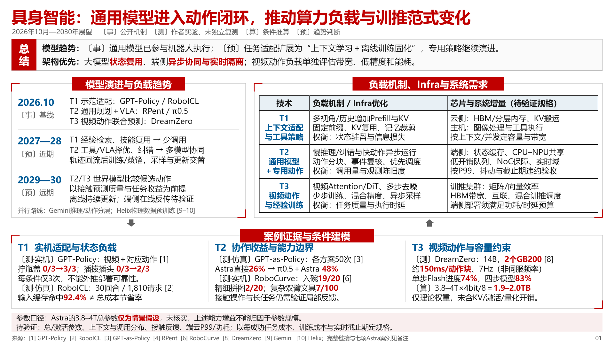

# 算力负载洞察 · Compute Workload Insight

把模型与应用演进转化为可审议的算力负载、Infra优化和芯片/系统需求，生成中文阅读型洞察PPT或页面文案。

**分析链条：** 模型/应用变化 → 负载变量 → 计算、访存、通信与调度 → Infra优化 → 有条件的系统需求。

## 示例模板

[下载可编辑单页PPT](assets/standard-topic-example.pptx) · [模板使用说明](references/template-guide.md)

示例为具身智能2026—2030专题，展示结构和证据标识方法。其中模型、参数、实验与预测属于示例内容，使用时需要重新核验。原始参考照片未包含在此仓库中。

## 安装

将仓库克隆到个人技能目录下的`compute-workload-insight`文件夹。Codex默认目录为`~/.codex/skills/`；如果设置了`CODEX_HOME`，则使用其`skills/`目录。已有同名技能时先备份再选择性更新。

## 使用

> 使用 $compute-workload-insight，分析某项模型技术2026—2030年的变化，面向算力产品线决策。输出1页标准专题PPT，写清技术趋势、负载机制、建模证据、Infra优化与系统需求；区分事实、实测、推算和预测，缺数据时列待验证项。

也可以只要求分析框架、页面文案、定量建模或审阅已有页，不会默认扩展成完整演示稿。

## 内容

- `SKILL.md`：技能入口与使用边界。
- `agents/openai.yaml`：技能名称和默认提示。
- `references/`：分析字段、五种页型、视觉规范、验收清单和模板说明。
- `assets/`：可编辑PPT示例与其渲染预览。

生成PPT时使用环境中的演示文稿制作与渲染能力。本仓库不附带字体、模型权重、API密钥或特定运行时依赖。
