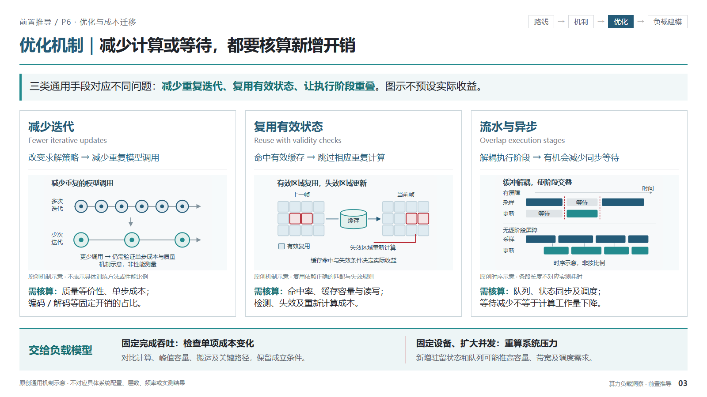

# 算力负载洞察 · Compute Workload Insight

将场景约束、技术路线与模型机制推导为算力负载、Infra优化和计算系统需求，生成或审阅中文阅读型洞察材料。按请求交付框架、文案、PPT或HTML，不默认扩展为整套材料。

**分析链条：** 场景需求与约束 → 技术路线与执行机制 → 负载变量变化 → 计算、访存、通信和调度影响 → 优化及代价 → 有条件的系统需求。

## 三页图文示例

[下载三页HTML](assets/prelude-examples.html) · [路线比较预览](assets/prelude-example-01.png) · [执行机制预览](assets/prelude-example-02.png) · [优化机制预览](assets/prelude-example-03.png)

将HTML下载到本地后，用浏览器打开即可离线翻页、点击图示放大并回看对应原稿整页。页面保留路线结构、机器人输入输出、联合生成及优化机制图，围绕主视觉配置分析、变量和结论。标题、公式与分析标注为HTML文字；引用图片内部文字仍是图像。

原有[可编辑单页PPT](assets/standard-topic-example.pptx)与[预览](assets/standard-topic-preview.png)继续保留，用于C型标准专题页。详见[模板使用说明](references/template-guide.md)。

## 页型结构

| 基础页型 A—E | 前置推导页型 P1—P6 |
|---|---|
| A 研究工作流 | P1 场景需求与性能约束 |
| B 全景路线矩阵 | P2 技术路线比较与演进 |
| C 标准专题洞察 | P3 业务流程与模型机制 |
| D 定量建模 | P4 规模变量与趋势证据 |
| E Agent系统专题 | P5 部署架构与资源分工 |
| | P6 优化技术与瓶颈变化 |

按缺失论证选择页面，不要求每次使用全部页型。前置页交付后续建模需要的变量、约束与适用条件。缺少数据时采用有边界的定性分析，不补造性能曲线或硬件阈值。

## 安装与使用

将仓库克隆到个人技能目录下的`compute-workload-insight`文件夹。默认目录为`~/.codex/skills/`；如果设置了`CODEX_HOME`，则使用其`skills/`目录。已有同名技能时先备份，再选择性更新。

> 使用 $compute-workload-insight，在已有定量页之前补充技术路线、执行机制和优化瓶颈变化三页，写清每页交给后续模型的变量与适用条件。保留有论证作用的机制图与输入输出样例。

也可只要求分析框架、页面文案、定量建模或审阅已有页。PPT制作需要所在环境具备演示文稿制作和渲染能力；HTML示例可直接离线查看。

## 仓库内容与来源

- `SKILL.md`、`agents/openai.yaml`：技能入口、使用边界和界面提示。
- `references/`：分析字段、页型、前置推导、视觉规则、验收清单及来源索引。
- `references/images/`：用户提供的参考照片及PDF精选页，用于学习论证与版式。
- `assets/`：三页HTML、逐页预览及原有标准专题PPT示例。
- [初创企业投资推荐技能](skills/startup-investment-recommendation/SKILL.md)：支持框架、文案、离线HTML与证据审阅。[三页虚构HTML示例](skills/startup-investment-recommendation/assets/investment-example.html) · [预览](skills/startup-investment-recommendation/assets/investment-example-preview.png)。该技能目录仅含通用方法与原创虚构示例，不含原始投资模板。

本仓库为私有。参考资料来自用户提供的材料，详细页码映射见[参考索引](references/source-gallery.md)。参考图和示例中的技术说法、数值及预测未因纳入模板而得到独立核验；新专题须重新判断证据状态。扫描图的微小标签受源文件清晰度限制。

仓库不包含完整工作区、构建临时文件、API密钥、模型权重或原始PDF文件。
